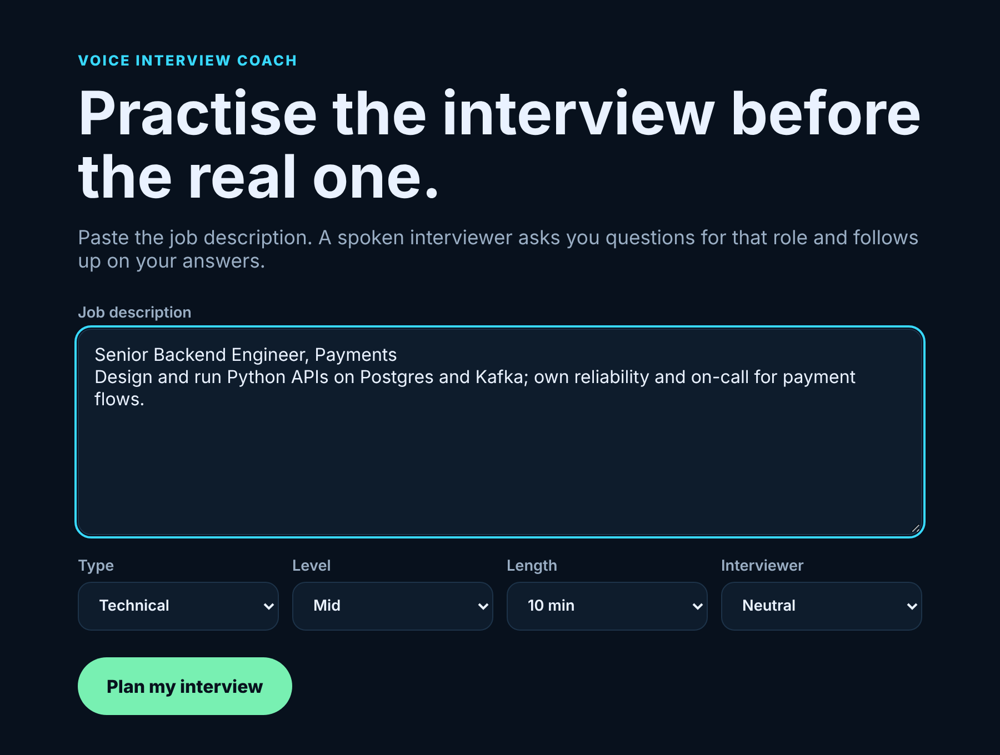
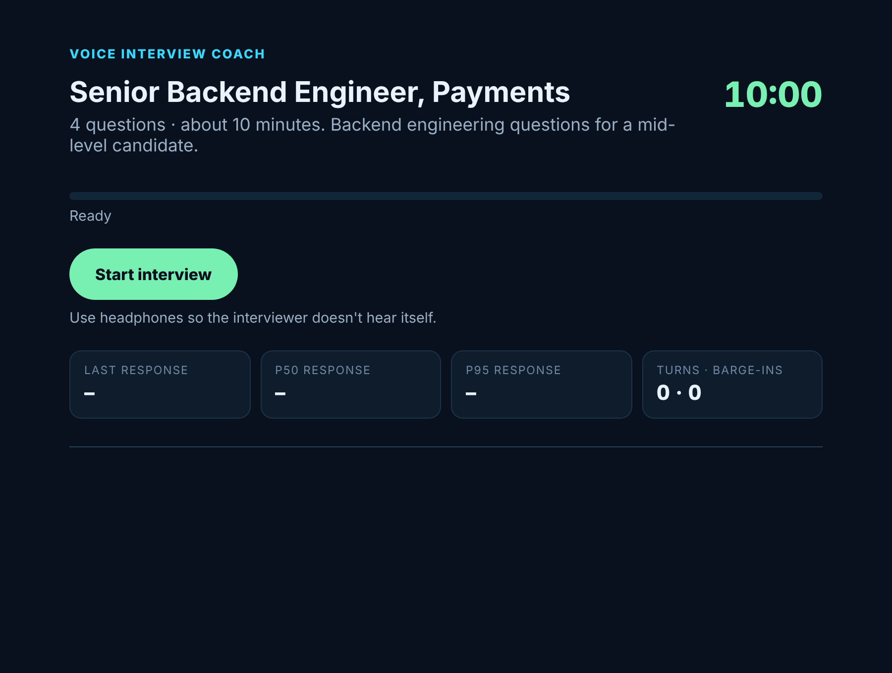

# 🎙️ Voice Interview Coach

[](https://github.com/yunus5603/Voice-Agent/actions/workflows/ci.yml)
[](LICENSE)
[](https://www.python.org/)
[](https://google.github.io/adk-docs/)
[](https://ai.google.dev/gemini-api/docs/live)
[](https://fastapi.tiangolo.com/)

**Practise the interview before the real one.** Paste a job description, and a
spoken AI interviewer runs a realistic interview for that role: it asks
questions out loud, follows up on what you actually said, keeps time, and
stops the moment you interrupt.



## How it works

1. **Plan.** Gemini Flash turns the job description into 3 to 6 tailored
   questions, each with what it probes, follow-ups, and a scoring rubric
   (structured output, validated with Pydantic). Without an API key, or if the
   call fails, the plan comes from curated [question packs](src/voice_agent/interview/packs/).
2. **Interview.** A Google ADK agent on Gemini Live runs the conversation over
   a WebSocket. The plan lives in session state, not the prompt: the agent asks
   for the next question through a tool, so it can't skip or repeat questions,
   and timing is enforced in code.
3. **Notes.** After each answer the interviewer saves a short private note
   through a tool. Notes and progress are kept for the feedback report.
4. **Report** *(next milestone)*. An evaluator scores each answer against its
   rubric with quoted evidence, plus delivery stats such as pace and filler words.



## Architecture


| Piece | Where | What it does |
| --- | --- | --- |
| Planner | [`interview/planner.py`](src/voice_agent/interview/planner.py) | Job description to `InterviewPlan`, with a question-pack fallback |
| Interview state | [`interview/state.py`](src/voice_agent/interview/state.py) | Pure functions: next question, notes, time left, end |
| Interviewer tools | [`interview/tools.py`](src/voice_agent/interview/tools.py) | `next_question`, `add_note`, `time_left`, `end_interview` |
| Interviewer agent | [`interview/agent.py`](src/voice_agent/interview/agent.py) | Persona and interview rules, built from session state |
| Voice bridge | [`server.py`](src/voice_agent/server.py) | REST API, WebSocket, validation, limits, cleanup |
| Latency | [`metrics.py`](src/voice_agent/metrics.py) | Per-turn response time, p50/p95, barge-ins |

More detail, including how interruptions, slow tools and guardrails work, is in
**[docs/architecture.md](docs/architecture.md)**.

## Quick start

You need Python 3.11 to 3.13, [uv](https://docs.astral.sh/uv/getting-started/installation/),
a Chromium-based browser, and a [Gemini API key](https://aistudio.google.com/apikey)
with Live API access.

```bash
git clone https://github.com/yunus5603/Voice-Agent.git
cd Voice-Agent
uv sync
cp .env.example .env          # then set GEMINI_API_KEY
uv run uvicorn voice_agent.server:app --reload --port 8002
```

Open <http://localhost:8002>, paste a job description, pick the interview type,
and click **Start interview**. Use headphones so the interviewer doesn't hear
itself.

### With Docker

```bash
docker build -t voice-interview-coach .
docker run --rm -p 8080:8080 --env-file .env \
  -e WS_ALLOWED_ORIGINS=http://localhost:8080 voice-interview-coach
```

### Deploy

See **[docs/deploy-cloud-run.md](docs/deploy-cloud-run.md)** for a Cloud Run
deploy with the key in Secret Manager.

## API

| Method | Path | Purpose |
| --- | --- | --- |
| `POST` | `/api/interviews` | Plan an interview. Body: `job_description`, `interview_type` (`behavioral` or `technical`), `level`, `minutes` (5 to 30), `persona`. Returns an `interview_id`; the questions stay on the server. |
| `GET` | `/api/interviews/{id}` | Status and how many questions were asked |
| `WS` | `/ws?interview_id=…` | The live interview. Each interview can be joined once. |
| `GET` | `/healthz` | Liveness probe |

The WebSocket carries 16 kHz PCM audio up, and audio, captions, `progress`,
`interview_ended` and per-turn `metrics` events down.

## Latency

Every completed turn produces a record, shown in the room's panel and logged
as one line (timings only, never transcript text):

```text
turn_metrics connection_id=3f9c1a2b7d4e turn=2 response_ms=… turn_ms=… tool_ms=[…] interrupted=False
```

See [Measuring latency](docs/architecture.md#measuring-latency) for what it
includes and how to collect numbers from a session.

## Configuration

| Variable | Default | Purpose |
| --- | --- | --- |
| `GEMINI_API_KEY` or `GOOGLE_API_KEY` | unset | Gemini authentication (without it, plans come from question packs and the live interview can't start) |
| `LIVE_MODEL` | `gemini-3.1-flash-live-preview` | Voice model for the interviewer |
| `TEXT_MODEL` | `gemini-3.6-flash` | Text model for planning |
| `WS_ALLOWED_ORIGINS` | `http://localhost:8002,http://127.0.0.1:8002` | Browser origins allowed to open the WebSocket |
| `MAX_ACTIVE_SESSIONS` | `20` | Concurrent live interviews before new ones get close code 1013 |
| `MAX_WS_MESSAGE_BYTES` | `32768` | Maximum WebSocket message size |
| `MAX_AUDIO_CHUNK_BYTES` | `16384` | Maximum decoded audio chunk size |
| `LOG_LEVEL` | `INFO` | Server log level |

## Tests

```bash
uv run pytest            # no network or API key needed
uv run ruff check .
uv run ruff format --check .
```

Gemini is never called in tests. The planner is tested against a fake client
(including failures), and the WebSocket tests run a scripted Gemini Live
session in which the **real interview tools** execute against session state.
One test drives a complete 5-question interview through the tools, which is
the gate for this milestone.

## Roadmap

- [x] **M1 Interview engine:** planning, interviewer agent, tools, question packs
- [ ] **M2 Web app:** React + Vite UI, AudioWorklet mic pipeline, captions, waveform
- [ ] **M3 Feedback report:** rubric scoring with quoted evidence, delivery stats, history
- [ ] **M4 Ship:** public demo with guest mode and cost caps
- [ ] **M5 Launch:** demo video, measured latency and eval results

## Contributing

The easiest way to help is a **question pack**: one YAML file of questions
for a role (frontend, data engineering, product management, …). See
[CONTRIBUTING.md](CONTRIBUTING.md).

## Learn how it was built

The voice bridge started as a hands-on workshop. The [`workshop/`](workshop/)
folder walks from a text-only agent to a hardened real-time voice service in
seven checkpoints, with a facilitator runbook.

## License

[MIT](LICENSE)
