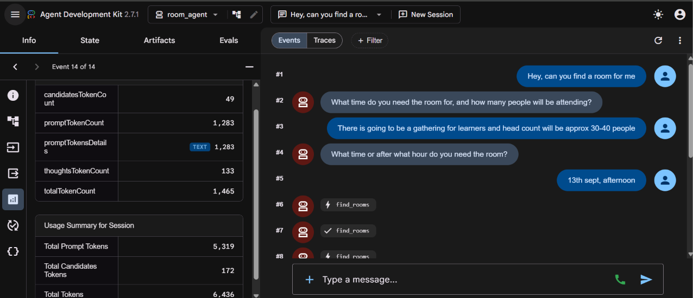
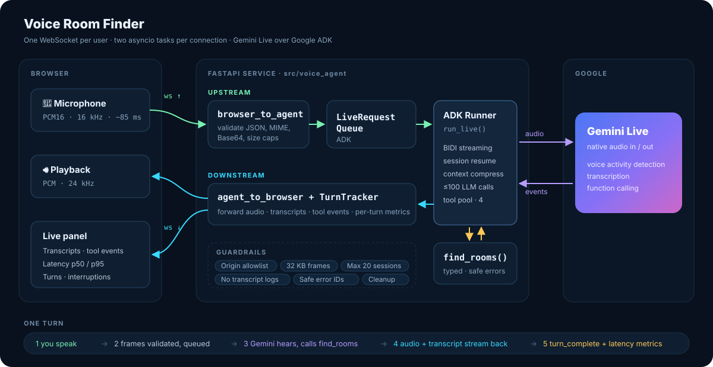

# 🎙️ Voice Room Finder: a real-time voice agent on Google ADK + Gemini Live

[](https://github.com/yunus5603/Voice-Agent/actions/workflows/ci.yml)
[](LICENSE)
[](https://www.python.org/)
[](https://google.github.io/adk-docs/)
[](https://ai.google.dev/gemini-api/docs/live)
[](https://fastapi.tiangolo.com/)

Talk to it, and it finds you a meeting room. Interrupt it mid-sentence and it
stops and listens. Change your mind ("actually, after four") and it uses the
correction.

Under the hood, the browser streams 16 kHz PCM over a WebSocket to a FastAPI
service that bridges it to a **Gemini Live** session through **Google ADK**.
The agent calls typed tools, streams audio and transcripts back, and the server
measures response latency for every turn.



## Highlights

- **Real-time, full-duplex voice** with native audio in and out, and live transcripts.
- **Barge-in:** speak over the agent and playback stops instantly; the next turn uses your correction.
- **Tool calling** with typed Python functions and structured errors, so failures are explained, not leaked.
- **Latency you can see:** per-turn response time, tool time, p50/p95 and barge-in count in the UI and in logs.
- **Production guardrails:** origin allowlist, frame and audio size limits, session caps, LLM call budgets, context compression, session resumption, privacy-safe logs.
- **Tested without an API key:** end-to-end WebSocket tests replay a scripted Gemini Live session.
- **Ships as a container** with a Cloud Run guide; CI on Python 3.11 to 3.13.

## How it works



The full turn-by-turn sequence, how interruptions and slow tools are handled,
and how latency is measured are in **[docs/architecture.md](docs/architecture.md)**.

## Quick start

You need Python 3.11 to 3.13, [uv](https://docs.astral.sh/uv/getting-started/installation/),
a Chromium-based browser, and a [Gemini API key](https://aistudio.google.com/apikey)
with Live API access.

```bash
git clone https://github.com/yunus5603/Voice-Agent.git
cd Voice-Agent
uv sync
cp .env.example .env          # then set GEMINI_API_KEY
uv run uvicorn voice_agent.server:app --reload --port 8002
```

Open <http://localhost:8002>, click **Connect microphone**, and try:

- "Find a room after three for six people."
- Interrupt it: "Actually, make it after four."
- "Book it." (It explains that it only finds rooms.)

Headphones help prevent the agent from hearing itself.

### With Docker

```bash
docker build -t adk-voice-agent .
docker run --rm -p 8080:8080 --env-file .env \
  -e WS_ALLOWED_ORIGINS=http://localhost:8080 adk-voice-agent
```

### Deploy

See **[docs/deploy-cloud-run.md](docs/deploy-cloud-run.md)** for a Cloud Run
deploy with the key in Secret Manager.

## Latency

Every completed turn produces a record like this, both in the browser panel and
as a log line (timings only, never transcript text):

```text
turn_metrics connection_id=3f9c1a2b7d4e turn=2 response_ms=… turn_ms=… tool_ms=[…] interrupted=False
```

`response_ms` runs from the last user transcription chunk to the first agent
audio chunk. See [Measuring latency](docs/architecture.md#measuring-latency)
for what it does and doesn't include, and how to collect numbers from a session.

## Configuration

| Variable | Default | Purpose |
| --- | --- | --- |
| `GEMINI_API_KEY` or `GOOGLE_API_KEY` | unset | Gemini authentication |
| `LIVE_MODEL` | `gemini-3.1-flash-live-preview` | Voice model |
| `TEXT_MODEL` | `gemini-3.6-flash` | Text model (workshop checkpoints 00 to 02) |
| `WS_ALLOWED_ORIGINS` | `http://localhost:8002,http://127.0.0.1:8002` | Browser origins allowed to open the WebSocket |
| `MAX_WS_MESSAGE_BYTES` | `32768` | Maximum WebSocket message size |
| `MAX_AUDIO_CHUNK_BYTES` | `16384` | Maximum decoded audio chunk size |
| `MAX_ACTIVE_SESSIONS` | `20` | Concurrent live sessions before new ones get close code 1013 |
| `LOG_LEVEL` | `INFO` | Server log level |

## Project structure

```text
.
├── src/voice_agent/
│   ├── server.py        # FastAPI app: WebSocket bridge, validation, limits, cleanup
│   ├── agent.py         # ADK agent and system prompt
│   ├── room_tools.py    # Tools the agent can call
│   ├── metrics.py       # Per-turn latency tracking
│   └── static/          # Browser client: mic capture, playback, metrics panel
├── tests/               # Unit + end-to-end WebSocket tests (no API key needed)
├── docs/                # Architecture, deployment, screenshots
├── workshop/            # The step-by-step workshop this app grew out of
├── Dockerfile
└── pyproject.toml
```

## Tests

```bash
uv run pytest            # 28 tests, no network or API key
uv run ruff check .
uv run ruff format --check .
```

The suite covers room filtering and tool failures, message and audio
validation, origin and capacity guards, a full scripted turn over the
WebSocket (transcripts, tool events, audio, metrics), barge-in forwarding,
session-slot cleanup, latency math, and a check that no API key is committed.

## Learn how it was built

This project started as a 55-minute hands-on workshop. The
[`workshop/`](workshop/) folder walks from a text-only agent to this hardened
voice service in seven checkpoints, with a facilitator runbook.

## Roadmap

- [ ] Replace `ScriptProcessorNode` with an `AudioWorklet`
- [ ] Real calendar backend (Google Calendar / Microsoft Graph)
- [ ] OpenTelemetry metrics and traces for `turn_metrics`
- [ ] Authentication and per-user rate limits for public deployments
- [ ] Conversation evals for corrections, tool failures and adversarial requests

## Contributing

Contributions are welcome. Start with [CONTRIBUTING.md](CONTRIBUTING.md); new
tools and calendar backends are good first projects.

## License

[MIT](LICENSE)
