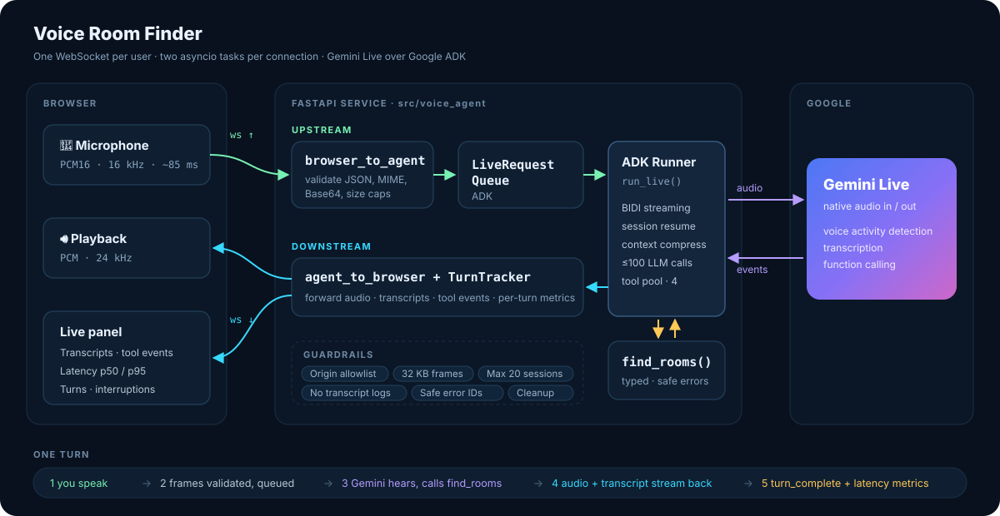

# Architecture

The app is a single FastAPI service. `POST /api/interviews` plans an interview
from a job description; the browser then streams microphone audio over one
WebSocket per interview, and the server bridges it to a Gemini Live session
through Google ADK. Code references are to [`src/voice_agent/`](../src/voice_agent/).

## Before the call: planning

The planner ([`interview/planner.py`](../src/voice_agent/interview/planner.py))
asks Gemini Flash for an `InterviewPlan` using structured output
(`response_schema=InterviewPlan`), with examples from the best-matching
question pack in the prompt. The result is normalised: question count, level
and length are pinned to the request, ids are made unique slugs, and missing
rubrics are filled from the pack. Any failure falls back to the pack itself, so
planning never blocks an interview. The plan stays on the server; the browser
only gets an id, the role title and the question count.

When the WebSocket opens, the plan is written to ADK session state
(`state["interview"]`) and a short kickoff message is queued so the
interviewer greets the candidate first.



## One conversational turn

1. **Capture.** The browser records the mic, downsamples to 16 kHz PCM16 and
   sends a JSON frame (`{"type":"audio","data":"<base64>"}`) about every 85 ms.
2. **Validate.** `browser_to_agent` rejects frames over 32 KB, bad JSON, wrong
   MIME types, invalid Base64 or audio chunks over 16 KB, then calls
   `LiveRequestQueue.send_realtime()`.
3. **Understand.** The ADK runner streams the audio to Gemini Live, which
   detects the end of the answer, transcribes it, and decides to call
   `add_note(...)` and then `next_question()`.
4. **Act.** ADK runs the tools in a bounded thread pool (4 workers). They read
   and write `state["interview"]` through pure functions in
   [`interview/state.py`](../src/voice_agent/interview/state.py), and return the
   next question with its follow-ups, or `time_up` / `no_more_questions`.
5. **Respond.** Gemini streams 24 kHz audio and an output transcript.
   `agent_to_browser` forwards audio, captions and tool events, plus a
   `progress` event (question n of N, never the question text) and
   `interview_ended`.
6. **Measure.** On `turn_complete`, `TurnTracker` emits the turn's latency
   record, which is logged and sent to the browser panel.

Two asyncio tasks run per connection, `browser_to_agent` (upstream) and
`agent_to_browser` (downstream). The server waits on whichever finishes first,
cancels the other, closes the queue and frees the session slot in a `finally`
block, so a dropped tab or a Gemini error never leaks a live session.

## Why the plan lives in state, not the prompt

Putting all the questions in the system prompt works in a demo and fails in
practice: the model skips questions, asks two at once, or runs over time. Here
the prompt only describes *how* to interview. *What* to ask comes from
`next_question`, one question at a time; `time_left` reports the remaining
budget and suggests moving on when an answer overruns its share; and the state
machine refuses new questions once time is up. All of it is deterministic code
with unit tests, including a full scripted interview.

When the session ends, the final state (progress and notes) is copied to the
interview record for the feedback report.

## Interruptions (barge-in)

Gemini Live runs voice activity detection on the incoming stream. When the
user starts speaking while the agent is talking:

1. Gemini stops generating and ADK emits an event with `interrupted=True`.
2. The server forwards `{"type":"interrupted"}` immediately.
3. The browser stops every scheduled `AudioBufferSourceNode` and resets its
   playback clock, so stale audio is dropped instead of finishing the old
   sentence.
4. The new utterance is handled as the next turn, and the system prompt tells
   the agent to use the speaker's newest correction ("actually, after three").

The interruption is recorded in the turn metrics, so barge-in rate is visible
in the UI and logs.

## Slow and failing tools

A voice agent cannot go silent for five seconds. The approach, demonstrated in
[`workshop/checkpoints/04_slow_failure`](../workshop/checkpoints/04_slow_failure):

- The agent says it is checking **before** it calls a slow tool.
- Tools return structured errors (`{"status":"error","retryable":true}`) instead
  of raising, so the model can apologise in plain language without leaking a
  stack trace.
- The agent does not retry automatically; it offers another time instead.
- Tool calls run in a bounded thread pool, and `max_llm_calls` caps how many
  model calls one session can make.

## Guardrails at the edge

| Risk | Control |
| --- | --- |
| Cross-site WebSocket hijacking | `Origin` allowlist (`WS_ALLOWED_ORIGINS`), close code 1008 |
| Oversized or malformed frames | 32 KB message cap, 16 KB decoded audio cap, strict JSON, Base64 and MIME checks |
| Quota exhaustion | `MAX_ACTIVE_SESSIONS` (close code 1013 when full), `max_llm_calls=100` |
| Very long sessions | Context window compression (100k trigger, 80k sliding window) and session resumption handles |
| Transcript leakage | Logs carry connection IDs, outcomes and timings only, never transcript text |
| Opaque failures | Users get a short error reference ID; the full trace stays in server logs |

## Measuring latency

[`metrics.py`](../src/voice_agent/metrics.py) turns the event stream into a
record per turn:

| Field | Meaning |
| --- | --- |
| `response_ms` | Last user transcription chunk to first agent audio chunk |
| `tool_ms` | Function call to function response, per call |
| `turn_ms` | First event of the turn to `turn_complete` |
| `interrupted` | Whether the user barged in |

The session also keeps p50/p95 response time, tool p50, turn count and
interruption count. Each turn is logged as one line, for example:

```text
turn_metrics connection_id=3f9c1a2b7d4e turn=2 response_ms=612 turn_ms=4310 tool_ms=[3] interrupted=False
```

and streamed to the browser, where the panel under the connect button shows
the latest values.

**Caveat:** input transcription trails the end of speech slightly, so
`response_ms` is a close lower bound on what the user perceives. Browser
playback buffering adds a little on top. For an end-to-end number, record the
screen with audio and measure from end of speech to first sound.

To collect numbers from a session:

```bash
uv run uvicorn voice_agent.server:app --port 8002 2>&1 | tee session.log
grep turn_metrics session.log
```
